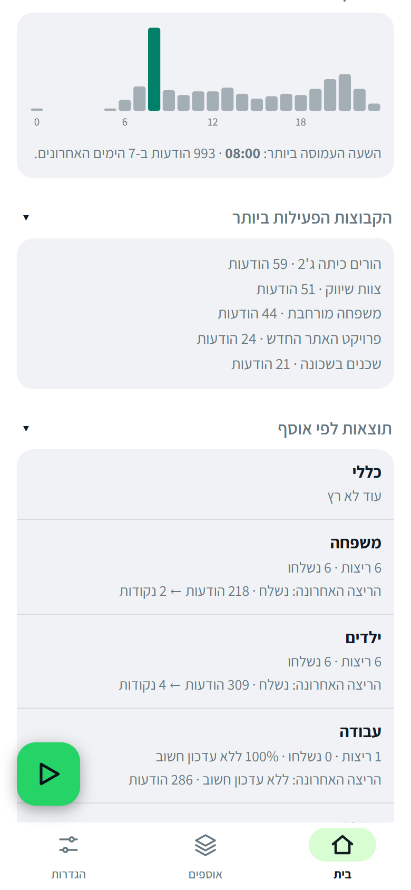
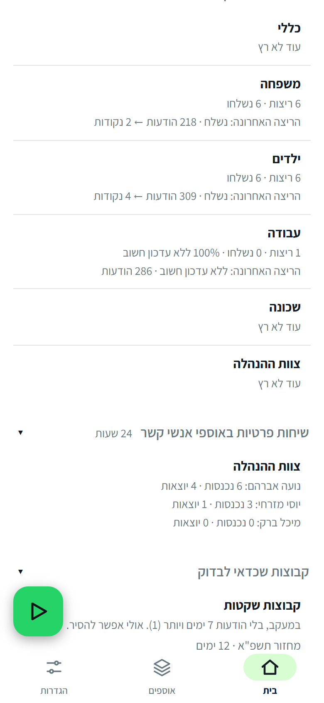
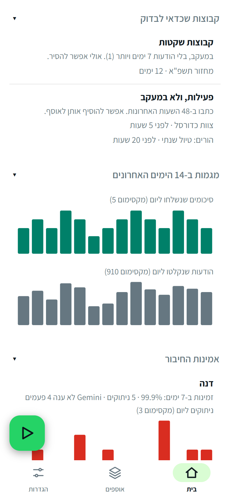
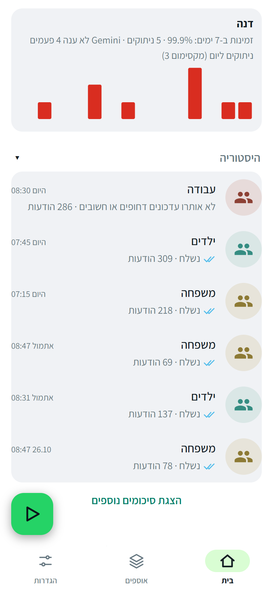
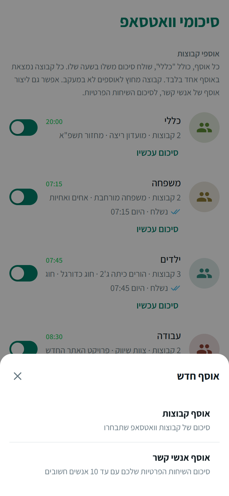
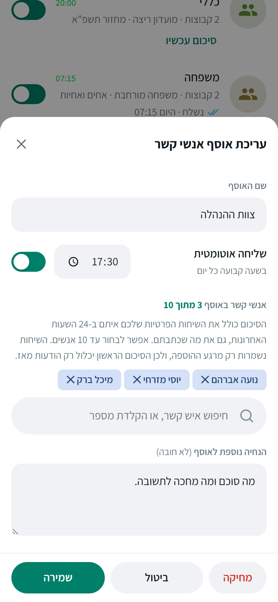
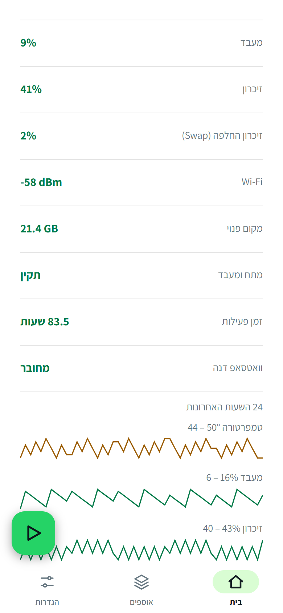
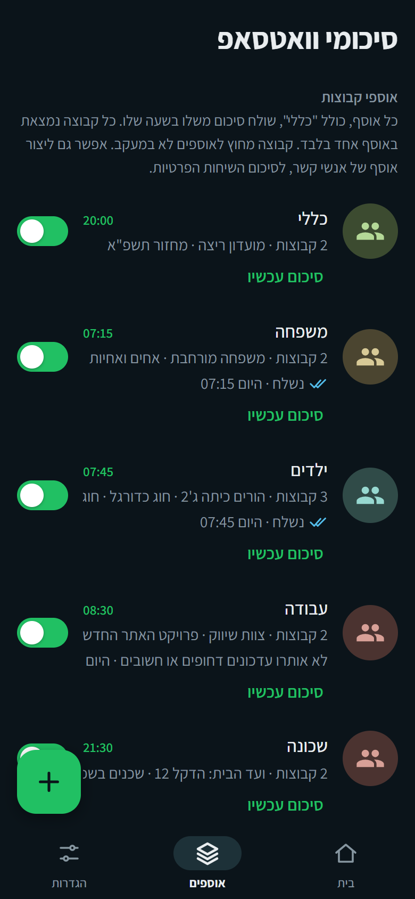

# WhatsApp Group Summarizer

A small self-hosted server that listens to your WhatsApp groups, asks Google Gemini what is **important or urgent**, and sends you a short summary on WhatsApp every morning. If nothing matters, no message is sent. Everything is managed from a mobile-friendly web dashboard (Hebrew, right-to-left).

[עברית / Hebrew README](README.md)

> ## ⚠️ Disclaimer: read carefully before any use
>
> **Use of this software is entirely at your own risk.** It is provided "AS IS", **without warranty of any kind**. It is **not an official product** of WhatsApp, Meta or Google, and connects to WhatsApp in an **unofficial** way that may **violate their terms of service and get your WhatsApp account permanently banned**. Message content **is sent to Google Gemini**, and you alone are responsible for the lawfulness of that processing, for privacy and for participants' consent. Summaries are AI-generated and **may be wrong or omit urgent information**: do not rely on them for anything critical. The authors are **not liable for any damages**, including loss of an account or data.
>
> **Using, installing or running the software means you accept the [full Disclaimer and Terms of Use](DISCLAIMER.md).** If you do not agree, do not use it.


## Features

- **Collections:** group your chats by topic ("Work", "Family", "Kids"), each with its own send time and its own prompt. Each morning you get a summary of the **previous day** per collection.
- **Concise:** only what is important or urgent; nothing important means no message.
- **Several accounts:** link more than one WhatsApp number (e.g. a couple). Each account has its own password and sees only itself; the first one with a password is the manager.
- **Auto-reply:** a fixed message to chosen people during chosen hours, optionally lightly personalised by AI.
- **People collections:** a summary of your private chats with up to 10 important people, both what they wrote and what you wrote.
- **Live dashboard on the home screen:** today's counters, when the groups are active, results per collection, groups worth a look, connection reliability and the health of the device (temperature, memory, Wi-Fi, power). Tested on Raspberry Pi and Windows; designed for Linux and macOS too.
- **Phone alerts** (ntfy) when an account stays disconnected for 5 minutes or more, or a summary fails. Short drops that reconnect by themselves do not alert.
- History import, daily backups, 7-day message retention.

## What it looks like

<table><tr>
<td align="center"><br><sub>Home: status, today's counters and scheduled summaries</sub></td>
<td align="center"><br><sub>Home: when the groups are active, and the busiest groups</sub></td>
<td align="center"><br><sub>Home: results per collection and private chats</sub></td>
</tr><tr>
<td align="center"><br><sub>Home: groups worth a look, and trends</sub></td>
<td align="center"><br><sub>Home: connection reliability</sub></td>
<td align="center"><br><sub>Collections: time and prompt per collection, with the default "General"</sub></td>
</tr></table>

> All names, numbers and texts in the images are **demo data**; nothing real. A dark mode follows the phone's setting.

## Read this first

The full, binding text is in the [Disclaimer](DISCLAIMER.md). The key points:

> - **This is not an official WhatsApp tool.** It links as a "companion device" through an unofficial library ([Baileys](https://github.com/WhiskeySockets/Baileys)). That goes against WhatsApp's terms of service and your account can be restricted or banned. Use at your own risk, ideally with a number you can afford to lose.
> - **Privacy:** group names, sender names and message text of the groups you choose are **sent to Google Gemini**. On the free tier Google may use the data. Do not include sensitive groups (medical, legal, other people's personal data) unless you accept that. A paid key has different terms.
> - **No transport encryption:** the dashboard is plain HTTP. Fine on a home network; use [Tailscale](https://tailscale.com) or similar for remote access.
> - The `auth/` folder holds **your WhatsApp account keys**. Anyone with those files controls the account. Never copy or publish them.

## Requirements

- An always-on machine: Raspberry Pi (a Zero W works, slowly), mini PC, home server or VPS. About 100 MB of RAM per linked account (max 4 accounts).
- Node.js 18 or newer.
- A free Gemini API key from [Google AI Studio](https://aistudio.google.com/app/apikey).
- Your phone, once, to scan a QR code (WhatsApp, Linked devices).

## Install

```bash
# 1. Node.js 18+ (see nodejs.org). On a Raspberry Pi Zero / Pi 1 (armv6) use the unofficial build:
cd /tmp
curl -O https://unofficial-builds.nodejs.org/download/release/v18.20.4/node-v18.20.4-linux-armv6l.tar.xz
sudo tar -xJf node-v18.20.4-linux-armv6l.tar.xz -C /usr/local --strip-components=1

# 2. Code and dependencies
sudo apt install -y git
git clone https://github.com/arielgalil/whatsapp-group-summarizer.git whatsapp-summarizer
cd whatsapp-summarizer
npm install

# 3. Try it
npm start        # then open http://localhost:3000
```

### How to open the dashboard

**For security the server is reachable, by default, only from the machine it runs on.** What you do depends on where it is installed:

| Your situation | What to do |
|---|---|
| **The machine has a screen and a browser** (for example Windows, or a Raspberry Pi with a monitor) | Open `http://localhost:3000` in the browser. That is all. |
| **No screen** (a Raspberry Pi in a cupboard that you reach over SSH) | Pick one of the two options below. |

**Option A. SSH tunnel (the simplest and the safest):** on your own computer, in a terminal, run:

```bash
ssh -L 3000:localhost:3000 <user>@<pi-address>
```

Leave that window open and open `http://localhost:3000` in the browser **on your own computer**. Continue with the setup from there. (On Windows, `ssh` is available in PowerShell.)

**Option B. Open it to every device at home (the phone too):**

1. Start the server like this: `HOST=0.0.0.0 npm start`
2. Open `http://<pi-ip-address>:3000` in a browser (`hostname -I` shows the address).
3. **Set a password right away** (see "First-time setup"). Until you do, the server answers only your home network.

When you run it as a permanent service (step 4 below), in `deploy/whatsapp-summarizer.service` delete the `#` at the start of the line `#Environment=HOST=0.0.0.0`, then restart the service.

Stop the manual run with `Ctrl+C`.

Run it permanently with systemd:

```bash
nano deploy/whatsapp-summarizer.service      # set User and the two paths
sudo cp deploy/whatsapp-summarizer.service /etc/systemd/system/
sudo systemctl daemon-reload
sudo systemctl enable --now whatsapp-summarizer
journalctl -u whatsapp-summarizer -f         # logs
```

<table><tr>
<td align="center"><br><sub>New collection: groups or people</sub></td>
<td align="center"><br><sub>Edit a group collection: name, time, groups, prompt</sub></td>
<td align="center"><br><sub>A people collection: up to 10 contacts</sub></td>
</tr><tr>
<td align="center"><br><sub>An auto-reply rule</sub></td>
<td align="center"><br><sub>Settings</sub></td>
<td align="center"><br><sub>Device health: values and 24-hour charts</sub></td>
</tr><tr>
<td align="center"><br><sub>Password sign-in</sub></td>
<td align="center"><br><sub>Dark mode: home</sub></td>
<td align="center"><br><sub>Dark mode: collections</sub></td>
</tr></table>

## Install on Windows

Works like Linux, with a few differences. Suited to an old PC that stays on.

### 1. Install Node.js and Git

In PowerShell (or from [nodejs.org](https://nodejs.org) and [git-scm.com](https://git-scm.com/download/win)):

```powershell
winget install OpenJS.NodeJS.LTS
winget install Git.Git
```

Close the window and open a new PowerShell. `node -v` should show 18 or newer.

### 2. Get it, install, run

```powershell
git clone https://github.com/arielgalil/whatsapp-group-summarizer.git whatsapp-summarizer
cd whatsapp-summarizer
npm install
npm start
```

On first start Windows asks about the firewall: allow **private networks**. The dashboard opens at `http://localhost:3000` on the same PC. To reach it from a phone on the same network, start with `$env:HOST="0.0.0.0"; npm start`, find the PC's address (`ipconfig`, the IPv4 line) and open `http://<address>:3000`. **Set a password right away.** Continue with "First-time setup" below. Stop with `Ctrl+C` (the server saves its files before exiting).

### 3. Keep it running

**Simple option, nothing extra to install:** put a shortcut to `deploy\windows-start.bat` in your Startup folder (`Win+R`, then `shell:startup`). The server starts when you sign in and restarts if it crashes. Fits a PC where the user stays signed in.

**Recommended option, a service that runs without signing in**, using [NSSM](https://nssm.cc). In PowerShell **as Administrator**, from the project folder:

```powershell
winget install NSSM.NSSM
$dir = (Get-Location).Path
$node = (Get-Command node).Source
nssm install WhatsAppSummarizer $node "--experimental-global-webcrypto server.js"
nssm set WhatsAppSummarizer AppDirectory $dir
nssm set WhatsAppSummarizer AppStopMethodConsole 20000      # sends Ctrl+C and waits up to 20 s for the save
nssm set WhatsAppSummarizer AppExit Default Restart
nssm set WhatsAppSummarizer AppStdout "$dir\server.log"
nssm set WhatsAppSummarizer AppStderr "$dir\server.log"
nssm set WhatsAppSummarizer AppRotateFiles 1
nssm start WhatsAppSummarizer
```

Stop / start: `nssm stop WhatsAppSummarizer`, `nssm start WhatsAppSummarizer`. The log is `server.log` in the folder.

### 4. Windows specifics

- **Sleep:** Settings, System, Power, Sleep: **Never** (when plugged in). A sleeping PC receives nothing.
- **Windows Update** reboots the PC. The service (or the startup shortcut) comes back by itself, but messages sent while it was off are not recovered.
- **Do not kill the process** (Task Manager) while it is receiving: a normal stop (`Ctrl+C` or `nssm stop`) saves the files; a sudden kill can leave encryption keys half-written.
- **Diagnostics:** `curl.exe http://localhost:3000/_diag` (counters only, no content).
- **Updating:** stop the service, `git pull`, `npm install`, start it.

> Tested: a clean install and a manual start on Windows. The NSSM service and the startup shortcut were not tested on a clean PC; if something fails, please open an Issue.

## First-time setup (5 minutes)

1. **Password first:** Settings, "Security and system", "Dashboard password". Until you set one, anyone on your network can open the dashboard.
2. **Gemini key:** same section, "Gemini key".
3. **Link WhatsApp:** on the home screen press "Show QR code", then on the phone WhatsApp, Linked devices, Link a device. The code is valid for about a minute and refreshes itself.
4. **Create a group collection:** "Collections" tab, green "+" button, "Group collection": name, send time, and the groups (the list has a search box), plus an optional extra prompt. **Every group you pick is monitored, and a group in no collection is not read at all.**
5. **People collection (optional):** the same "+" button, "People collection". See "People collections" below.

> Every new account already has two empty collections, "General" (groups) and "Contacts" (people), so you can drop groups and contacts into them at once without creating anything first. You can rename them and set a time; the Contacts collection can be deleted (it does not come back), "General" cannot.
6. **Test:** on home press the green floating button, choose a collection, "Summarize now" (last 24 hours).
7. **The "General" collection** is the default. A group in it is summarised at its time (you can change it). Every group belongs to exactly one collection.

Capture starts only when the link is up and the group is monitored. Earlier messages are not available, except the short history WhatsApp sends right when you link a device (Settings, "History import").

## Good to know

- Scheduled summaries cover the **previous calendar day**; "Summarize now" covers the last 24 hours.
- "Nothing important/urgent" is recorded in the history and nothing is sent.
- **People collections:** "Collections", "+", "People collection": a name, an optional time, up to 10 contacts (search by name or type a number) and an optional prompt. The summary covers your **private chats** with them in the last 24 hours, in both directions, one section per person. Only chats with the people you picked are stored, and only from the moment you add them; they are kept for 2 days (group messages: 7 days), so the first summary only contains messages since then. The chat text is **sent to Gemini**, like group text. Contacts that WhatsApp identifies by an internal id (`@lid`) are stored only if WhatsApp also provides their phone number.
- **The home dashboard** shows only the signed-in user's own account; a manager sees their own by default and can look at another account only by choosing it in the account selector. It is ordered most important first; every section folds and unfolds and the state is remembered on the device. It is built for phones. It shows the status and anything that needs attention (a disconnected account, a failed summary, queued messages, Gemini not answering); today's numbers (summaries sent out of those scheduled, messages captured against the 7-day average, failures, 7-day availability); when the groups are active (24-hour chart over the last 7 days) and the busiest groups; results per collection (runs, how often nothing important came up, messages in and bullets out for the last run); the private chats of people collections; groups worth a look (monitored groups silent for 7+ days, and unmonitored groups that wrote in the last 48 hours); 14-day trends and connection reliability (availability is counted from the minutes the account was connected, and starts accumulating when this version is installed); and, for the manager only, the device: temperature, CPU, memory, Wi-Fi, free space, on a Raspberry Pi also power, each with a 24-hour chart. Readings are read-only; a value the system cannot provide is not shown.
- **Auto-reply:** Settings, "Auto-reply". Private chats only, new messages only, at most 20 replies per hour, once per person per cool-down. AI personalisation is off by default; when on, the sender's first name and message are sent to Gemini and any failure falls back to your own text.
- **Phone alerts:** install the free [ntfy](https://ntfy.sh) app, subscribe to **exactly** the topic name shown in Settings, press "Send test". An alert goes out when an account stays disconnected for 5 minutes or more, when capture stalls, when the server is overloaded and when a summary fails; short drops that reconnect by themselves are only logged.
- **Remote access:** do not expose the dashboard to the internet. Use Tailscale on the server and your phone.
- **Files:** `config.json` (settings, password hashes), `auth/` (WhatsApp keys, secret), `data/` (messages for 7 days, contacts, history), `backups/` (daily, 7 days). All are in `.gitignore`. Backups are on the same machine, so copy `config.json` and `auth/` somewhere safe now and then.

## Security

- **Without a password the server answers only the local network** (the machine itself, home LAN, Tailscale) and refuses public addresses. Set a password on first start (the home screen reminds you).
- **Passwords** are stored as a hash (scrypt + salt), 8+ characters, with attempt limiting. Each account sees only itself, and system settings are manager-only.
- **Listening:** the default is `127.0.0.1`, this machine only. To open it to your home network set `HOST=0.0.0.0` (and set a password at once). For remote access prefer Tailscale or an SSH tunnel, and never open the port to the internet.
- **Plain HTTP:** acceptable on a home network, but the typed password travels unencrypted. For remote access use Tailscale or an HTTPS reverse proxy, and never forward the port to the internet.
- Security headers (CSP, `X-Frame-Options`), rejection of dangerous keys in requests, owner-only permissions on `auth/` and `data/`, and a hardened service file.
- **Full details, what is and is not covered, and how to report a vulnerability: [SECURITY.md](SECURITY.md).** `npm test` and `node test/security.mjs` check the protections.

## Updating

```bash
git pull && npm install && sudo systemctl restart whatsapp-summarizer
```

Do **not** restart repeatedly: stopping in the middle of receiving can leave encryption keys half-written and messages stop decrypting. One clean restart is enough.

## Troubleshooting

| Problem | What to do |
|---|---|
| No QR code | Reload the page and wait a few seconds, or press "Show QR code". |
| `Closed (428)` again and again, messages not captured | Link again (Settings, "History import"). |
| `Closed (401)` | The device was removed on the phone. Link again. |
| `Closed (440)` | A second copy of the server is using the same `auth/` folder. Keep one. |
| Recipient sees "Waiting for this message" | The server could not re-send after a restart. The text is on the home screen under "Last summary". |
| Forgot the password | Stop the server, edit `config.json`: delete the account's `auth` field (and `authManager` if needed), start again. The dashboard stays open until you set a new password. |

Diagnostics from the machine itself: `curl localhost:3000/_diag` (counters only, no content).

## Configuration

| | |
|---|---|
| `COUNTRY_CODE` env var or `countryCode` in `config.json` | Country code used to complete local numbers such as `052-1234567`. Default `972` (Israel). |
| `port` in `config.json` | Dashboard port. Default `3000`. |
| `HOST` env var or `host` in `config.json` | Listen address. Default `127.0.0.1` (this machine only). `0.0.0.0` opens it to the whole network. |

## Development

```bash
npm test       # unit tests: time windows, phone numbers, the send queue, collections, private chats, device readings, daily counters
```

One server file (`server.js`) and one static dashboard (`public/index.html`, no build step). Contributions welcome.

## License

[MIT](LICENSE). Provided as is, without warranty.
