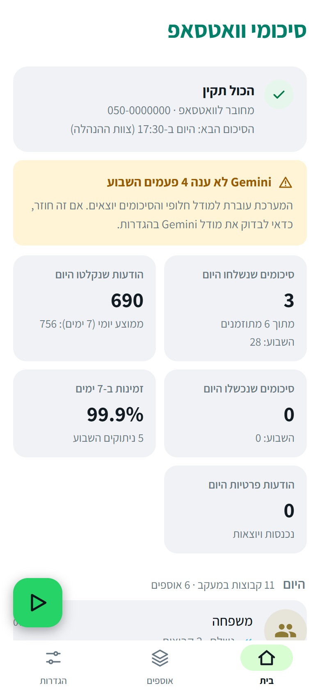
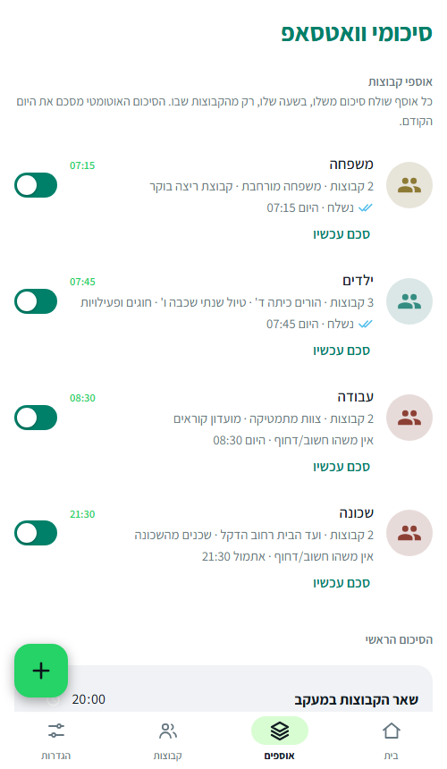
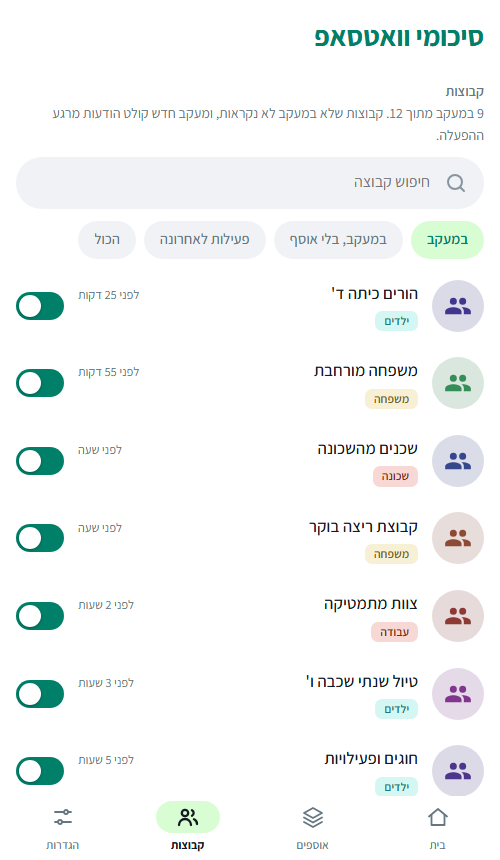
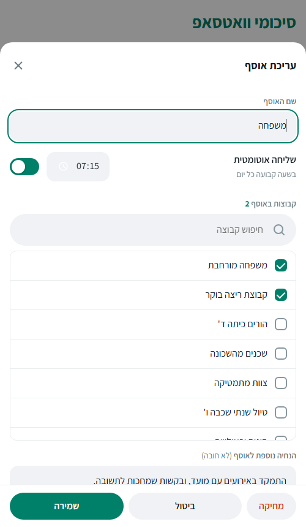
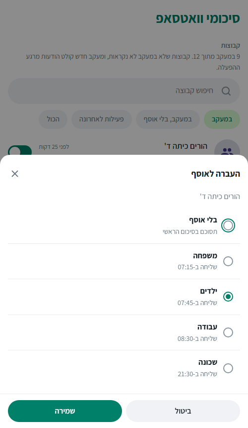
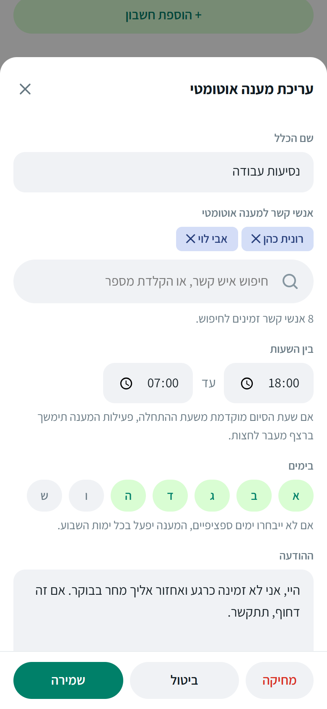
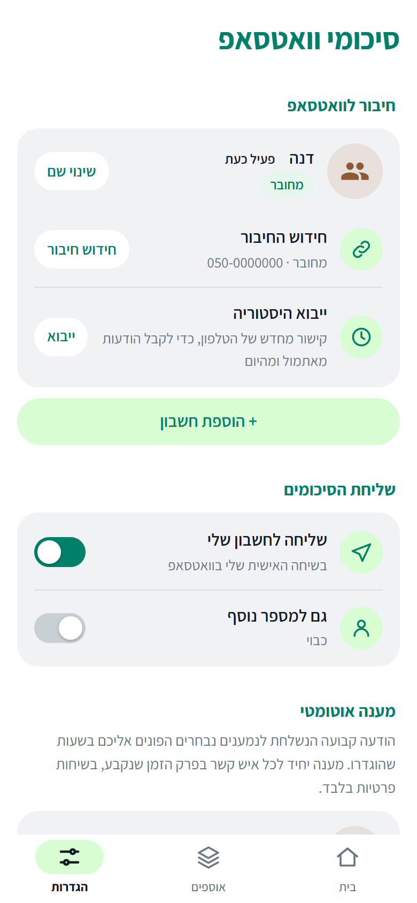
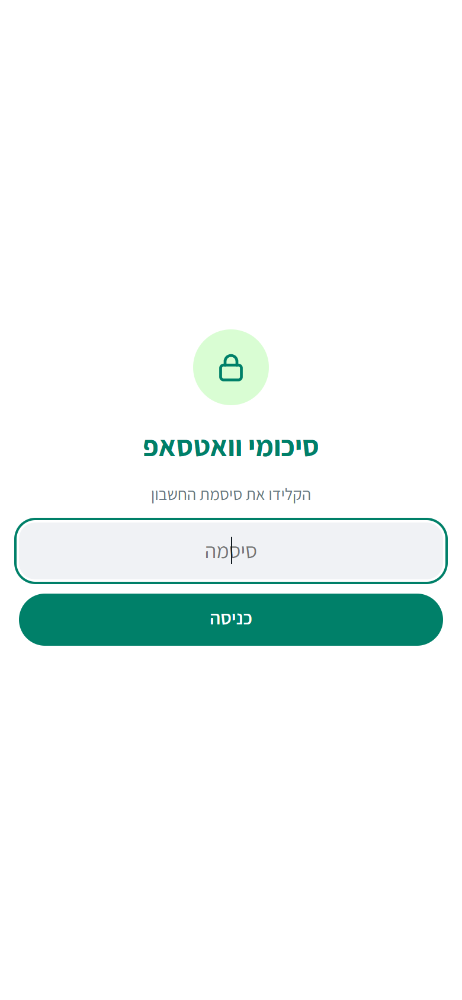
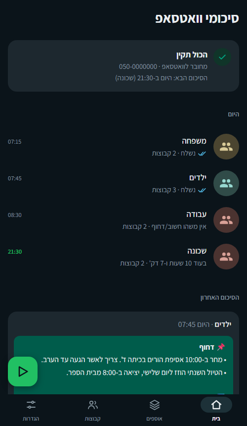

<div dir="rtl" align="right">

# סיכומי וואטסאפ

שרת קטן שמאזין לקבוצות הוואטסאפ שלך, שואל את Gemini (של גוגל) מה **חשוב או דחוף**, ושולח לך כל בוקר סיכום קצר בהודעת וואטסאפ. אם אין שום דבר חשוב, לא נשלחת הודעה. הכול מנוהל מדשבורד בדפדפן, בעברית ומותאם לטלפון.

[English README](README.en.md)

> ## ⚠️ הצהרת אחריות: קראו היטב לפני כל שימוש
>
> **השימוש בתוכנה הוא על אחריותכם הבלעדית.** התוכנה ניתנת "כמות שהיא", **ללא כל אחריות**. היא **אינה מוצר רשמי** של וואטסאפ, Meta או Google, ומתחברת לוואטסאפ בדרך **בלתי רשמית** שעלולה **להפר את תנאי השימוש שלהם ולגרום לחסימה קבועה של חשבון הוואטסאפ שלכם**. תוכן ההודעות **נשלח ל-Google Gemini**, ואתם האחראים לחוקיות העיבוד, לפרטיות ולהסכמת המשתתפים. הסיכומים נוצרים בבינה מלאכותית ו**עלולים להיות שגויים או להשמיט מידע דחוף**: אין להסתמך עליהם בעניינים קריטיים. המחברים **אינם אחראים לכל נזק**, לרבות אובדן חשבון או מידע.
>
> **השימוש, ההתקנה וההפעלה מהווים הסכמה מלאה ל[הצהרת האחריות ותנאי השימוש המלאים](DISCLAIMER.md).** מי שאינו מסכים, לא ישתמש בתוכנה.


## מה זה עושה

- **אוספים:** מקבצים קבוצות לנושא ("עבודה", "משפחה", "ילדים"), ולכל אוסף שעת שליחה והנחיה משלו. כל בוקר מגיע סיכום של **היום הקודם** לכל אוסף.
- **סיכום תמציתי:** רק מה שחשוב ודחוף. אם אין, לא נשלחת הודעה.
- **כמה חשבונות:** אפשר לחבר כמה מספרי וואטסאפ (למשל בני זוג), וכל חשבון עם סיסמה משלו ורואה רק את עצמו.
- **מענה אוטומטי:** הודעה קבועה לאנשים מסוימים בשעות מסוימות, עם אפשרות להתאמה אישית קלה בעזרת AI.
- **התראות לטלפון** (ntfy) כשהחיבור נופל או סיכום נכשל.
- **ייבוא היסטוריה, גיבויים יומיים, ושמירה של 7 ימים בלבד.**

## איך זה נראה

<table dir="ltr"><tr>
<td align="center"><br><sub>בית: מצב, הסיכומים של היום והסיכום האחרון</sub></td>
<td align="center"><br><sub>אוספים: שעה והנחיה לכל אוסף</sub></td>
<td align="center"><br><sub>קבוצות: מעקב, ושיוך לאוסף</sub></td>
</tr></table>

> כל השמות, המספרים והטקסטים בתמונות הם **נתוני דוגמה**. אין בהם מידע אמיתי. יש גם מצב כהה, לפי הגדרות הטלפון.

## לפני שמתחילים: חשוב לדעת

התמצית המלאה והמחייבת נמצאת ב-[הצהרת האחריות](DISCLAIMER.md). להלן עיקרי הדברים:

> **אזהרות. קראו לפני ההתקנה.**
>
> - **זה לא כלי רשמי של וואטסאפ.** השרת מתחבר כ"מכשיר מקושר" בעזרת ספרייה בלתי רשמית ([Baileys](https://github.com/WhiskeySockets/Baileys)). השימוש מנוגד לתנאי השימוש של וואטסאפ, ויש סיכון שהחשבון יוגבל או יחסם. השתמשו על אחריותכם, והעדיפו מספר שאתם יכולים להרשות לעצמכם לאבד.
> - **פרטיות:** שמות הקבוצות, שמות הכותבים ותוכן ההודעות שבקבוצות הנבחרות **נשלחים אל Gemini (גוגל)** כדי לסכם אותם. בגרסה החינמית גוגל עשויה להשתמש בנתונים. אל תכללו קבוצות רגישות (רפואי, משפטי, מידע אישי של אחרים) אלא אם הבנתם והסכמתם לכך. אפשר להשתמש במפתח בתשלום עם תנאי פרטיות אחרים.
> - **אין הצפנת תעבורה:** הדשבורד עובד ב-HTTP. ברשת ביתית זה בסדר, אבל גישה מבחוץ צריכה לעבור דרך [Tailscale](https://tailscale.com) או דומה (ראו "גישה מרחוק").
> - הקבצים בתיקיית `auth/` הם **המפתחות של חשבון הוואטסאפ שלכם**. מי שמחזיק בהם שולט בחשבון. אל תעתיקו אותם, אל תעלו אותם לשום מקום.

## מה צריך

| | |
|---|---|
| **מחשב שפועל כל הזמן** | Raspberry Pi (גם Zero W עובד, אבל איטי), מיני-PC, שרת ביתי או VPS. הוא צריך להישאר דלוק ומחובר לאינטרנט. |
| **Node.js 18 ומעלה** | ראו התקנה בהמשך. |
| **מפתח Gemini** | חינמי, מ-[Google AI Studio](https://aistudio.google.com/app/apikey). |
| **הטלפון** | לסריקת קוד QR פעם אחת (וואטסאפ ← מכשירים מקושרים). |
| **זיכרון** | כ-100MB לכל חשבון מחובר. עד 4 חשבונות מוגבלים בקוד. |

## התקנה (Raspberry Pi / לינוקס)

### 1. התקנת Node.js

על Raspberry Pi 3 ומעלה, או כל מחשב רגיל, מתקינים Node 18 או 20 לפי [nodejs.org](https://nodejs.org/en/download).

על **Raspberry Pi Zero / Pi 1** (ארכיטקטורת armv6) אין גרסה רשמית, ומשתמשים בבנייה הלא-רשמית:

```bash
cd /tmp
curl -O https://unofficial-builds.nodejs.org/download/release/v18.20.4/node-v18.20.4-linux-armv6l.tar.xz
sudo tar -xJf node-v18.20.4-linux-armv6l.tar.xz -C /usr/local --strip-components=1
node -v   # אמור להציג v18.20.4
```

### 2. הורדת הקוד והתקנת התלויות

```bash
sudo apt install -y git
git clone https://github.com/arielgalil/whatsapp-group-summarizer.git whatsapp-summarizer
cd whatsapp-summarizer
npm install
```

(ב-Pi Zero ההתקנה לוקחת כמה דקות.)

### 3. הפעלה ראשונה לבדיקה

```bash
npm start
```

אמור להופיע `Open in a browser on this network: ...`. פותחים בדפדפן באותה רשת: `http://<כתובת-ה-IP-של-המחשב>:3000`.
(את הכתובת מוצאים עם `hostname -I`.)

מפסיקים עם `Ctrl+C`. עכשיו נגדיר שירות שרץ לבד.

### 4. הרצה קבועה כשירות (systemd)

```bash
# ערכו את User ואת שתי הנתיבים בקובץ לפי המשתמש והתיקייה שלכם
nano deploy/whatsapp-summarizer.service
sudo cp deploy/whatsapp-summarizer.service /etc/systemd/system/
sudo systemctl daemon-reload
sudo systemctl enable --now whatsapp-summarizer
systemctl status whatsapp-summarizer
```

יומן השרת: `journalctl -u whatsapp-summarizer -f`.

## התקנה ב-Windows

מתאים למחשב שנשאר דלוק (למשל מחשב ישן בבית). זה עובד כמו בלינוקס, עם הבדלים קטנים.

### 1. התקנת Node.js ו-Git

ב-PowerShell (או מהאתרים [nodejs.org](https://nodejs.org) ו-[git-scm.com](https://git-scm.com/download/win)):

```powershell
winget install OpenJS.NodeJS.LTS
winget install Git.Git
```

סוגרים את החלון ופותחים PowerShell חדש, כדי שהפקודות יזוהו. בדיקה: `node -v` אמור להציג גרסה 18 ומעלה.

### 2. הורדה, התקנה והפעלה

```powershell
git clone https://github.com/arielgalil/whatsapp-group-summarizer.git whatsapp-summarizer
cd whatsapp-summarizer
npm install
npm start
```

בהפעלה הראשונה Windows שואל על חומת האש: מאשרים **רשתות פרטיות**. הדשבורד נפתח ב-`http://localhost:3000` באותו מחשב. כדי לפתוח אותו מהטלפון באותה רשת, מוצאים את כתובת המחשב עם `ipconfig` (שורת IPv4) ופותחים `http://<כתובת>:3000`.

המשך ההגדרה זהה: ראו "הגדרה ראשונה בדשבורד" למטה. עוצרים עם `Ctrl+C` (השרת שומר את הקבצים לפני שהוא נסגר).

### 3. שיהיה פועל תמיד

**אפשרות פשוטה, בלי התקנות נוספות:** יוצרים קיצור דרך לקובץ `deploy\windows-start.bat`, ושמים אותו בתיקיית ההפעלה (`Win+R`, ואז `shell:startup`). השרת יעלה בכל כניסה של המשתמש, ויופעל מחדש אם יקרוס. מתאים כשהמשתמש נשאר מחובר למחשב.

**אפשרות מומלצת, כשירות שרץ גם בלי כניסה:** בעזרת [NSSM](https://nssm.cc). ב-PowerShell **כמנהל** (בתיקיית הפרויקט):

```powershell
winget install NSSM.NSSM
$dir = (Get-Location).Path
$node = (Get-Command node).Source
nssm install WhatsAppSummarizer $node "--experimental-global-webcrypto server.js"
nssm set WhatsAppSummarizer AppDirectory $dir
nssm set WhatsAppSummarizer AppStopMethodConsole 20000      # שולח Ctrl+C ומחכה עד 20 שניות לשמירה
nssm set WhatsAppSummarizer AppExit Default Restart
nssm set WhatsAppSummarizer AppStdout "$dir\server.log"
nssm set WhatsAppSummarizer AppStderr "$dir\server.log"
nssm set WhatsAppSummarizer AppRotateFiles 1
nssm start WhatsAppSummarizer
```

עצירה והפעלה: `nssm stop WhatsAppSummarizer` ו-`nssm start WhatsAppSummarizer`. היומן בקובץ `server.log` בתיקייה.

### 4. דברים ש-Windows דורש

- **מצב שינה:** הגדרות ← מערכת ← צריכת חשמל ← "שינה": **אף פעם** (כשהמחשב מחובר לחשמל). מחשב שנרדם מפסיק לקלוט הודעות.
- **עדכוני Windows** מפעילים מחדש את המחשב. השירות (או קיצור ההפעלה) יעלה שוב לבד, אבל הודעות שהגיעו בזמן הכיבוי לא יימצאו.
- **אל תכבו בכוח** (הרג התהליך ב-Task Manager) בזמן קליטה: עצירה רגילה (`Ctrl+C`, או `nssm stop`) שומרת את הקבצים, והרג פתאומי עלול להשאיר מפתחות הצפנה בחצי מצב.
- **אבחון:** `curl.exe http://localhost:3000/_diag` מציג מונים, בלי תוכן.
- **עדכון:** עוצרים את השירות, ואז `git pull`, `npm install`, ומפעילים.

> נבדק: התקנה נקייה והפעלה ידנית ב-Windows. הגדרת השירות עם NSSM וקיצור ההפעלה לא נבדקו על מחשב נקי, ואם משהו לא עובד, פתחו Issue.

## הגדרה ראשונה בדשבורד (5 דקות)

1. **סיסמה (עשו קודם!):** הגדרות ← "אבטחה ומערכת" ← "סיסמה לדשבורד". עד שמגדירים, כל מי שברשת יכול להיכנס. החשבון הראשון שמקבל סיסמה הוא **המנהל**: רואה את כל החשבונות ואת הגדרות המערכת. לכל חשבון נוסף אפשר לקבוע סיסמה משלו, והוא רואה רק את עצמו.
2. **מפתח Gemini:** הגדרות ← "אבטחה ומערכת" ← "מפתח Gemini" ← שינוי, ומדביקים את המפתח.
3. **קישור וואטסאפ:** בעמוד הבית יופיע "הצג קוד QR". בטלפון: וואטסאפ ← מכשירים מקושרים ← קישור מכשיר, וסורקים. הקוד תקף כדקה ומתחדש. אחרי הצלחה כתוב "מחובר".
4. **בחירת קבוצות:** טאב "קבוצות": מפעילים מעקב על הקבוצות שרוצים (המתג). **קבוצה שלא במעקב לא נקראת בכלל.**
5. **אוסף:** טאב "אוספים" ← הכפתור הירוק "+" ← שם, שעת שליחה, והקבוצות. אפשר להוסיף "הנחיה נוספת" לאוסף, למשל "התמקד באסיפות הורים ובהסעות".
6. **בדיקה:** בבית, הכפתור הירוק הצף ← בחרו אוסף ← "סכם עכשיו". בודק את 24 השעות האחרונות.
7. **שעת ברירת המחדל:** קבוצות במעקב שלא באוסף מסוכמות יחד ב"סיכום הראשי" (טאב אוספים).

> **שימו לב:** הקליטה מתחילה רק ברגע שהחיבור פעיל והקבוצה במעקב. הודעות מלפני כן לא ייקלטו, חוץ מהיסטוריה שוואטסאפ שולח ברגע הקישור (ראו "ייבוא היסטוריה").

## איך משתמשים

| טאב | מה יש בו |
|---|---|
| **בית** | מצב החיבור, הסיכומים של היום, הסיכום האחרון, היסטוריית שליחות. כפתור "סכם עכשיו". |
| **אוספים** | יצירה ועריכה של אוספים, שעת שליחה, הנחיה לכל אוסף, הפעלה והשהיה. |
| **קבוצות** | רשימת כל הקבוצות. מסננים: במעקב / בלי אוסף / פעילות לאחרונה. לחיצה על קבוצה מעבירה אותה בין אוספים. |
| **הגדרות** | חשבונות, לאן לשלוח, מענה אוטומטי, הנחיה כללית ל-AI, מודל Gemini, סיסמה והתראות. |

- **הסיכום האוטומטי מסכם את היום הקודם** (00:00 עד 24:00). "סכם עכשיו" מסכם 24 שעות אחרונות.
- **"אין משהו חשוב/דחוף"** נרשם בהיסטוריה, ולא נשלחת הודעה.
- **הנחיה ל-AI:** הנחיה כללית בהגדרות, והנחיה נוספת לכל אוסף. כך שולטים במה נחשב חשוב.
- **מועד שכבר עבר** לא נחשב דחוף.

<table dir="ltr"><tr>
<td align="center"><br><sub>עריכת אוסף: שם, שעה, קבוצות והנחיה</sub></td>
<td align="center"><br><sub>לחיצה על קבוצה: העברה לאוסף אחר</sub></td>
<td align="center"><br><sub>כלל מענה אוטומטי</sub></td>
</tr><tr>
<td align="center"><br><sub>הגדרות</sub></td>
<td align="center"><br><sub>כניסה עם סיסמה</sub></td>
<td align="center"><br><sub>מצב כהה</sub></td>
</tr></table>

### מענה אוטומטי

הגדרות ← "מענה אוטומטי" ← "כלל מענה חדש": שם, למי (חיפוש באנשי הקשר שלכם, או הקלדת מספר), טווח שעות (גם חוצה חצות), ימים, הודעה, וכמה זמן לא לחזור על המענה לאותו אדם.
- נשלח רק בצ'אט פרטי, רק על הודעות חדשות, ועד 20 מענים בשעה.
- **התאמה אישית עם AI** (כבוי כברירת מחדל): פנייה בשם הפרטי וניסוח שמתאים להודעה, בלי להוסיף תוכן. שם השולח וההודעה שלו נשלחים ל-Gemini. אם ה-AI נכשל נשלח הנוסח שלכם.

### התראות לטלפון (ntfy)

הגדרות ← "אבטחה ומערכת" ← "התראות לטלפון". מתקינים את האפליקציה החינמית [ntfy](https://ntfy.sh), נרשמים **בדיוק** לשם הנושא שמוצג, ולוחצים "שליחת בדיקה". מקבלים התראה כשהחיבור נופל, כשהקליטה נתקעת, כשהשרת עמוס וכשסיכום נכשל. ההודעה לא מכילה תוכן מוואטסאפ.

### ייבוא היסטוריה

וואטסאפ שולח היסטוריה (כיומיים) רק ברגע קישור מכשיר חדש. כדי לייבא: הגדרות ← "ייבוא היסטוריה" ← סריקת QR. הקישור הישן מוחלף בחדש (אחר כך מוחקים את המכשיר הישן ברשימת המכשירים בטלפון).

### כמה חשבונות

הגדרות ← "הוספת חשבון". כל חשבון מקבל קוד QR משלו, קבוצות, אוספים והנחיה משלו. מומלץ להגדיר סיסמה לכל חשבון.

### גישה מרחוק

לא חושפים את הדשבורד לאינטרנט. מתקינים [Tailscale](https://tailscale.com) על המחשב ועל הטלפון, ופותחים `http://<כתובת-tailscale>:3000`. החיבור מוצפן.

## אבטחה

- **בלי סיסמה, השרת עונה רק לרשת המקומית** (המחשב עצמו, רשת ביתית, Tailscale) וחוסם כתובות ציבוריות. מגדירים סיסמה בהפעלה הראשונה (הדשבורד מזכיר זאת בעמוד הבית).
- **סיסמאות** נשמרות כטביעת אצבע (scrypt + salt), 8 תווים לפחות, עם הגבלת ניסיונות. כל חשבון רואה רק את עצמו, והגדרות מערכת למנהל בלבד.
- **האזנה:** השרת מאזין לכל הממשקים (`0.0.0.0`) כדי שאפשר לפתוח את הדשבורד מהטלפון. כדי להגביל למחשב עצמו: `HOST=127.0.0.1` (למשל מאחורי reverse proxy או Tailscale Serve).
- **HTTP בלבד:** ברשת ביתית זה סביר, אבל סיסמה שמוקלדת עוברת בלי הצפנה. לגישה מרחוק השתמשו ב-Tailscale או ב-reverse proxy עם HTTPS, ואל תפתחו את הפורט לאינטרנט.
- כותרות אבטחה (CSP, `X-Frame-Options`), דחיית מפתחות מסוכנים בבקשות, הרשאות בעלים בלבד לתיקיות `auth/` ו-`data/`, וקובץ שירות מוקשח.
- **פרטים מלאים, מה מוגן ומה לא, ואיך מדווחים על פגיעות: [SECURITY.md](SECURITY.md).** `npm test` ו-`node test/security.mjs` בודקים את ההגנות.

## קבצים ואבטחה

| תיקייה | מה בה |
|---|---|
| `config.json` | ההגדרות: מפתח Gemini, קבוצות, אוספים, טביעות הסיסמאות (scrypt, לא הסיסמה עצמה). |
| `auth/` | **מפתחות וואטסאפ. סודי.** |
| `data/` | הודעות (7 ימים), אנשי קשר, היסטוריית שליחות, מצב המתזמן. |
| `backups/` | גיבוי יומי של ההגדרות ושל קבצי החיבור, 7 ימים. |

כל התיקיות האלה **בתוך ה-`.gitignore`** ולא עולות ל-git. אם אתם מפתחים: אל תוסיפו אותן ל-commit לעולם.
הגיבויים נמצאים על אותו מחשב. כדאי להעתיק מדי פעם את `config.json` ואת `auth/` למקום מוגן אחר. אם קובץ החיבור ייפגע, תצטרכו לסרוק QR מחדש.

## עדכון

```bash
cd whatsapp-summarizer
git pull
npm install
sudo systemctl restart whatsapp-summarizer
```

**אל תפעילו מחדש שוב ושוב:** כל כיבוי באמצע קליטה עלול להשאיר מפתחות הצפנה בחצי מצב, והתוצאה הודעות שלא מתפענחות. הפעלה אחת מסודרת אחרי עדכון מספיקה. השרת שומר קבצים לפני כיבוי, אז תנו לו כמה שניות.

## פתרון בעיות

| בעיה | מה לעשות |
|---|---|
| **לא מופיע QR** | רעננו את הדף וחכו כמה שניות. אם עדיין לא, לחצו "הצג קוד QR". |
| **"החיבור נופל וחוזר"** | ראו `journalctl -u whatsapp-summarizer -n 100`. אם רואים `Closed (428)` תכופות והודעות לא נקלטות: קשרו מחדש ("ייבוא היסטוריה"). |
| **`Closed (401)`** | הקישור נותק מהטלפון (נמחק ממכשירים מקושרים). קשרו מחדש. |
| **`Closed (440)`** | עותק נוסף של השרת רץ עם אותם קבצי `auth/`. השאירו עותק אחד בלבד. |
| **"בהמתנה להודעה זו" אצל המקבל** | השרת צריך לשלוח את ההודעה שוב ולא הצליח (בדרך כלל אחרי הפעלה מחדש). הסיכום עצמו מופיע בבית תחת "הסיכום האחרון". |
| **הדשבורד איטי** | `uptime` ו-`top`. ב-Pi Zero תקופה קצרה של עומס אחרי הפעלה מחדש היא רגילה. |
| **שכחתי את הסיסמה** | עצרו את השרת, ערכו את `config.json`: מחקו את השדה `auth` של החשבון (ואת `authManager` אם צריך), והפעילו מחדש. הדשבורד פתוח עד שמגדירים סיסמה חדשה. |
| **סיכום לא נשלח** | בדקו בבית: "הסיכום ... לא נשלח" עם סיבה. מפתח Gemini? המודל עמוס? המערכת מנסה מודלים חלופיים ומנסה שוב לאחר 20 דקות. |

אבחון מהמחשב עצמו (לא מהרשת): `curl localhost:3000/_diag` מציג מונים, ללא תוכן.

## משתני סביבה והגדרות

| | |
|---|---|
| `COUNTRY_CODE` או `countryCode` ב-`config.json` | קידומת מדינה להשלמת מספרים מקומיים. ברירת מחדל `972` (ישראל). |
| `port` ב-`config.json` | פורט הדשבורד. ברירת מחדל `3000`. |
| `HOST` או `host` ב-`config.json` | כתובת האזנה. ברירת מחדל `0.0.0.0` (כל הממשקים). `127.0.0.1` מגביל למחשב עצמו. |

## פיתוח

```bash
npm test      # בדיקות יחידה ללוגיקה (חלון שעות, מספרי טלפון, ניקוי סשנים וכו')
```

הקוד בשרת אחד (`server.js`) ודשבורד סטטי אחד (`public/index.html`, בלי build). תרומות ותיקונים מתקבלים בברכה.

## רישיון

[MIT](LICENSE). התוכנה ניתנת כמות שהיא, ללא אחריות.

</div>
